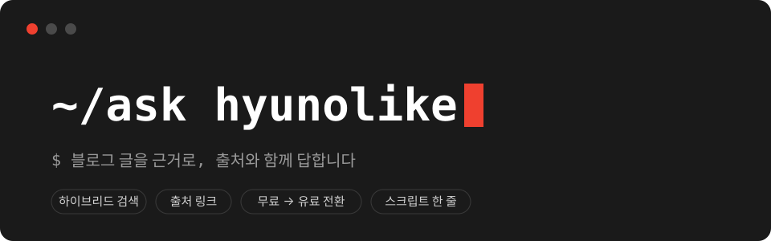
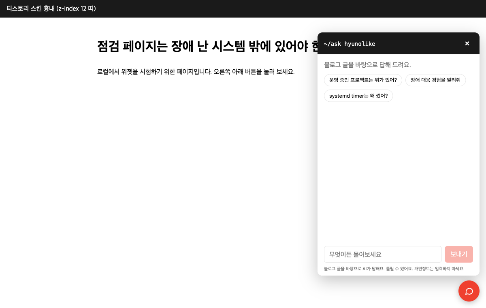
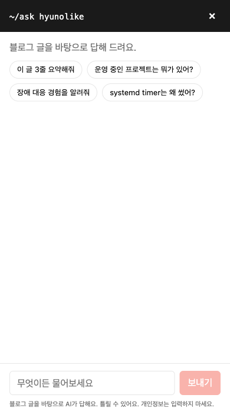
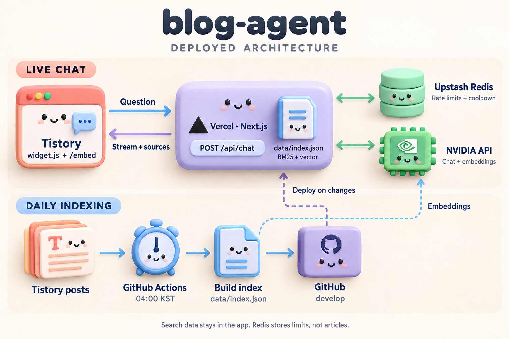

<div align="center">



<br>
<br>

**[hyunolike 기술 블로그](https://hyunolike.tistory.com)의 글을 근거로 답하고, 어느 글에서 가져왔는지 함께 알려주는 AI 채팅**


</div>

> [블로그에서 사용하기](https://hyunolike.tistory.com/) · [채팅 화면 바로 열기](https://blog-agent-ruddy.vercel.app/embed)

<br>

## 소개 영상 🎬

https://github.com/user-attachments/assets/a620696a-b0b8-47b7-994d-a1af05d0aa76

20초 소개 영상입니다. 영상 속 답변은 화면 시연용입니다. 원본은 [`docs/video/brag.mp4`](docs/video/brag.mp4)에 있습니다.

<br>

## 프로젝트 소개 📝

기술 블로그에 글이 70개를 넘어가면서, 처음 온 사람이 원하는 글을 찾기가 어려워졌습니다. 채용 담당자는 "장애를 어떻게 대응했는지"를 알고 싶어 하고, 검색으로 들어온 방문자는 "systemd timer를 왜 썼는지"만 궁금합니다. 두 사람 모두 글 목록을 처음부터 훑어야 했습니다.

`blog-agent`는 블로그 오른쪽 아래에 채팅 버튼을 하나 답니다. 질문을 받으면 블로그 글에서 관련된 부분을 찾아 답변의 근거로 제공하고, 인용한 글의 링크를 함께 보여줍니다. 모델에는 글에 없는 사실을 만들지 않고, 근거가 부족하면 그 한계를 밝히도록 지시합니다. AI 답변이므로 원문과 함께 확인해야 합니다.

<br>

## 핵심 기능 ✨

### 1. 블로그 글을 근거로 답합니다

답변의 `[1]` 같은 출처 번호를 누르면 해당 글로 이동합니다. 실제 인용한 글만 답변 아래 출처 카드로 보여줍니다.

### 2. 보고 있는 글을 알고 답합니다

글 페이지에서 채팅을 열면 "이 글 3줄 요약해줘" 같은 질문을 바로 할 수 있습니다. 인덱스에 있는 글이면 그 글의 요약을 첫 번째 근거로 넣고, 본문 조각도 함께 제공합니다.

### 3. 기술 용어를 정확히 찾습니다

벡터 검색과 키워드 검색을 함께 씁니다. `RequiresMountsFor`나 `ORA-28040`처럼 정확한 철자가 중요한 용어는 키워드 검색으로 보완합니다. 임베딩 호출이 실패해도 키워드 검색으로 계속 진행합니다.

### 4. 모델이 늦거나 실패하면 다른 모델이 이어받습니다

기본 모델이 답변을 시작하기 전에 실패하거나 지연되면 두 번째 모델로 넘깁니다. 두 모델이 모두 실패해도 검색된 관련 글 링크는 보여줍니다.

### 5. 스크립트 한 줄로 붙입니다

티스토리 스킨에 `<script>` 한 줄만 넣으면 됩니다. 채팅 화면은 iframe 안에서 돌아가서 블로그 스킨의 CSS와 서로 영향을 주지 않습니다.

<br>

## 화면 🖥️

실제 모델을 연결해 로컬에서 확인한 화면입니다.

| PC: 질문에 출처와 함께 답한 화면 | 모바일: 글 페이지에서 "이 글 3줄 요약해줘" |
| :---: | :---: |
|  |  |

<br>

## 기술 스택 💡

| 영역 | 기술 |
| --- | --- |
| 앱 | Next.js 16 (App Router), React 19, TypeScript 6 |
| AI | Vercel AI SDK 7, NVIDIA API 카탈로그 (답변 모델과 임베딩) |
| 검색 | 직접 구현한 BM25와 벡터 검색, RRF 결합 (별도 DB 없이 `data/index.json`) |
| 수집 | cheerio, turndown, GitHub Actions |
| 요청 제한 | Upstash Redis |
| 테스트 | Vitest |
| 배포 | Vercel |

<br>

## 구조 🏛



위쪽은 질문과 답변, 아래쪽은 검색 인덱스를 갱신하는 흐름입니다. 티스토리는 별도로 운영되며, 채팅 화면과 API는 Vercel에 배포됩니다.

- **Vercel:** `widget.js`, `/embed`, `/api/chat`을 제공합니다. 배포에 포함된 `data/index.json`을 읽어 메모리에서 BM25와 벡터 검색을 결합합니다.
- **NVIDIA API:** 질문과 글 조각의 임베딩을 만들고, 검색된 근거로 답변을 생성합니다.
- **Upstash Redis:** IP별 요청 수와 전체 일일 요청 수, 기본 모델의 일시 제한 상태를 공유합니다. 블로그 본문과 대화 기록을 저장하는 용도는 아닙니다.
- **GitHub Actions → develop → Vercel:** 바뀐 글을 수집해 인덱스를 갱신하고, 실제 변경이 있을 때 커밋과 재배포가 이어집니다.

대화 기록은 브라우저의 `sessionStorage`에 보관합니다. 서버에 대화 이력을 영구 저장하지 않으며, 답변 생성 시에는 최근 메시지를 모델 API로 보냅니다.

수집이 실패해도 채팅은 마지막으로 배포된 인덱스로 계속 동작합니다.

### 저장소 구조

```text
.
├── ingest/            # sitemap 읽기, 본문 추출, 조각 나누기, 인덱스 빌드
├── lib/               # 검색, 프롬프트, 모델 전환, 요청 제한
├── app/
│   ├── api/chat/      # 스트리밍 채팅 API
│   └── embed/         # iframe에 들어가는 채팅 화면
├── public/widget.js   # 티스토리 스킨이 불러가는 위젯
├── data/index.json    # 수집한 글과 검색용 임베딩
├── .github/workflows/ingest.yml  # 예약 수집과 인덱스 커밋
├── eval/              # 검색 품질과 답변 품질 평가
├── tests/             # 단위 테스트와 실제 글 HTML 테스트 데이터
└── docs/              # 구조도, 화면, 영상, 설계 문서
```

<br>

## 이렇게 만든 이유 🤔

#### 1. 벡터 DB를 두지 않았습니다

블로그 규모에서는 파일 하나를 읽어 메모리에서 비교하는 구성이 충분하다고 판단했습니다. 별도 검색 DB 없이 수집 결과를 배포에 포함하므로, 인덱스가 바뀌면 재배포가 필요합니다.

#### 2. 키워드 검색을 직접 만들었습니다

한국어 기술 글은 한글 문장 안에 영문 용어가 섞여 있습니다. 한글은 두 글자씩 끊어 색인하고 영문 용어는 단어 그대로 색인합니다. 형태소 분석기를 두지 않고도 기술 용어를 검색하고, 의미 검색과 함께 순위를 합칠 수 있습니다.

#### 3. 모델 전환은 첫 글자가 나가기 전에만 합니다

답변이 절반쯤 나오다가 다른 모델의 답으로 바뀌면 읽는 사람이 더 혼란스럽습니다. 그래서 답이 시작된 뒤에 끊기면 모델을 바꾸지 않고 "다시 시도" 버튼을 보여줍니다.

<br>

## 로컬 실행

Node.js 22 이상이 필요합니다. 저장소에 인덱스가 포함되어 있어, 기존 글로 채팅을 확인할 때는 수집을 다시 실행하지 않아도 됩니다.

```bash
npm ci
cp .env.example .env.local   # NVIDIA_API_KEY, CHAT_MODELS 채우기
npm run dev                 # http://localhost:3000/dev-host.html 에서 위젯 확인
```

인덱스를 갱신하려면 `npm run ingest`를 실행합니다. 로컬에서 Redis 설정을 비워두면 메모리 요청 제한을 사용하며, 배포에서는 인스턴스 사이에 요청 수를 공유하도록 Redis를 설정합니다.

검증 명령은 다음과 같습니다. 검색 평가에는 실제 NVIDIA API 호출이 필요합니다.

```bash
npm test
npm run build
npm run typecheck
npm run eval:retrieval
```

## 배포

Vercel에 저장소를 연결하고 프로덕션 브랜치를 `develop`으로 설정합니다.

### Vercel 환경변수

Production에 아래 변수를 설정합니다. 도메인 값은 자신의 배포 주소와 블로그 주소로 바꿉니다. API 키는 [NVIDIA API 카탈로그](https://build.nvidia.com)에서, Redis REST URL과 토큰은 Upstash에서 발급합니다. 키와 토큰은 서버 환경변수로 관리하고 저장소에 커밋하지 않습니다.

| 변수 | 타입 | 값 또는 용도 |
| --- | --- | --- |
| `NVIDIA_API_KEY` | Secret | NVIDIA API 키 |
| `CHAT_MODELS` | Config | `nvidia/nemotron-3-super-120b-a12b,openai/gpt-oss-20b` |
| `APP_ORIGIN` | Config | `https://blog-agent-ruddy.vercel.app` (끝에 `/` 없이) |
| `FRAME_ANCESTORS` | Config | `https://hyunolike.tistory.com` |
| `UPSTASH_REDIS_REST_URL` | Secret | Redis REST URL |
| `UPSTASH_REDIS_REST_TOKEN` | Secret | Redis REST 토큰 |

`EMBEDDING_MODEL`은 선택 사항입니다. 수집의 기본값은 `nvidia/nemotron-3-embed-1b`이며, 채팅은 인덱스에 기록된 모델로 질문을 임베딩합니다.

연결된 프로젝트에서 프로덕션을 배포하는 명령은 다음과 같습니다.

```bash
vercel deploy --prod --yes
```

환경변수를 바꾸면 재배포해야 합니다. Preview에서 채팅을 시험하려면 해당 환경에도 변수를 설정합니다.

### GitHub 자동 수집

Settings → Secrets and variables → Actions에 Secret `NVIDIA_API_KEY`를 등록합니다. Variable `EMBEDDING_MODEL`은 선택 사항입니다.

`ingest`는 매일 예약 실행되며 Actions 탭에서 수동으로도 실행할 수 있습니다. 변경된 내용이 있으면 `data/index.json`을 커밋하고, Vercel Git 연동으로 배포에 반영합니다.

### 티스토리 연결

스킨 편집 → HTML에서 `</body>` 바로 위에 아래 스크립트를 넣습니다. 다른 프로젝트로 배포했다면 스크립트 주소도 바꿉니다.

```html
<script src="https://blog-agent-ruddy.vercel.app/widget.js" defer></script>
```

PC 스킨의 위젯을 모바일에서도 쓰려면 관리 → 꾸미기 → 모바일에서 “모바일 웹 자동 연결”을 끄고 실제 기기에서 확인합니다.

### 모델 API 사용 범위

NVIDIA Developer Program의 무료 API는 개발과 평가 용도입니다. 일반 방문자 대상 정식 운영에는 운영을 허용하는 계약과 제공 환경을 갖추거나 다른 모델 제공자로 전환해야 합니다. 자세한 내용은 [NVIDIA 공식 FAQ](https://docs.api.nvidia.com/nim/docs/product)를 참고합니다.

<br>

## 만든 사람 👤

|  |
| :---: |
| [hyunolike](https://github.com/hyunolike) |
| [기술 블로그](https://hyunolike.tistory.com) |
