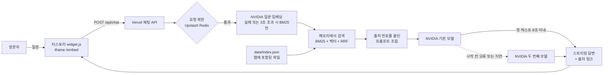
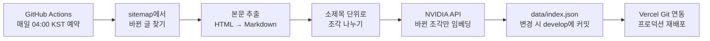

<div align="center">


<br>
<br>

**[hyunolike 기술 블로그](https://hyunolike.tistory.com)의 글을 근거로 답하고, 어느 글에서 가져왔는지 함께 알려주는 AI 채팅**


</div>

> **2026-10-11 기준:** Vercel 배포와 티스토리 스킨 연결을 마쳤습니다. 실제 블로그 위젯에서 질문 전송, 답변, 출처 링크 표시를 확인했습니다.
>
> [블로그에서 사용하기](https://hyunolike.tistory.com/) · [채팅 화면 바로 열기](https://blog-agent-ruddy.vercel.app/embed)

<br>

## 소개 영상 🎬

https://github.com/user-attachments/assets/a620696a-b0b8-47b7-994d-a1af05d0aa76

20초 소개 영상입니다. 영상은 모델을 연결하기 전에 만들어서, 영상 속 채팅 답변은 화면 시연용으로 넣은 문장입니다. 내용은 블로그 70번 글에 실제로 있는 내용입니다. 원본 파일은 [`docs/video/brag.mp4`](docs/video/brag.mp4)에 있습니다.

<br>

## 프로젝트 소개 📝

기술 블로그에 글이 70개를 넘어가면서, 처음 온 사람이 원하는 글을 찾기가 어려워졌습니다. 채용 담당자는 "장애를 어떻게 대응했는지"를 알고 싶어 하고, 검색으로 들어온 방문자는 "systemd timer를 왜 썼는지"만 궁금합니다. 두 사람 모두 글 목록을 처음부터 훑어야 했습니다.

`blog-agent`는 블로그 오른쪽 아래에 채팅 버튼을 하나 답니다. 질문을 받으면 블로그 글에서 관련된 부분을 찾아 답변의 근거로 제공하고, 인용한 글의 링크를 함께 보여줍니다. 모델에는 글에 없는 사실을 만들지 않고, 근거가 부족하면 그 한계를 밝히도록 지시합니다. AI 답변이므로 원문과 함께 확인해야 합니다.

<br>

## 핵심 기능 ✨

### 1. 블로그 글을 근거로 답합니다

답변의 `[1]` 같은 출처 번호를 누르면 해당 글로 이동합니다. 실제 인용한 글만 답변 아래 출처 카드로 보여줍니다. 경력 기간이나 수치는 원문대로 쓰도록 지시하지만, 모델이 출처 번호를 빠뜨리는 경우도 있어 모든 문장에 인용이 붙는다고 보장하지는 않습니다.

### 2. 보고 있는 글을 알고 답합니다

글 페이지에서 채팅을 열면 "이 글 3줄 요약해줘" 같은 질문을 바로 할 수 있습니다. 인덱스에 있는 글이면 그 글의 요약을 첫 번째 근거로 넣고, 본문 조각도 함께 제공합니다.

### 3. 기술 용어를 정확히 찾습니다

의미가 비슷한 글을 찾는 벡터 검색과 단어가 일치하는 글을 찾는 키워드 검색을 함께 씁니다. `RequiresMountsFor`나 `ORA-28040`처럼 정확한 철자가 중요한 용어는 키워드 검색으로 보완합니다. 질문 임베딩이 실패하거나 3초를 넘기면 키워드 검색만으로 계속 진행합니다.

### 4. 모델이 늦거나 실패하면 다른 모델이 이어받습니다

NVIDIA API 카탈로그의 모델로 답합니다. 기본 모델이 첫 답변 텍스트를 8초 안에 내보내지 못하거나 오류가 나면 두 번째 모델로 넘깁니다. 두 모델이 모두 실패해도 검색된 관련 글 링크는 보여줍니다. 현재 두 답변 모델과 임베딩 모두 NVIDIA API를 통해 호출합니다.

### 5. 스크립트 한 줄로 붙입니다

티스토리 스킨에 `<script>` 한 줄만 넣으면 됩니다. 채팅 화면은 iframe 안에서 돌아가서 블로그 스킨의 CSS와 서로 영향을 주지 않습니다.

<br>

## 화면 🖥️

아래 이미지는 로컬 서버에서 실제 모델이 답한 화면입니다. 배포된 위젯은 위의 블로그 링크에서 사용할 수 있습니다.

| PC: 질문에 출처와 함께 답한 화면 | 모바일: 글 페이지에서 "이 글 3줄 요약해줘" |
| :---: | :---: |
|  |  |

<br>

## 기술 스택 💡

| 영역 | 기술 |
| --- | --- |
| 앱 | Next.js 16 (App Router), React 19, TypeScript 6 |
| AI | Vercel AI SDK 7, NVIDIA API 카탈로그 (답변 모델과 임베딩) |
| 검색 | 직접 구현한 BM25와 벡터 검색, RRF 결합 (별도 DB 없이 `data/index.json`) |
| 수집 | cheerio, turndown, GitHub Actions |
| 요청 제한 | Upstash Redis |
| 테스트 | Vitest |
| 배포 | Vercel |

<br>

## 구조 🏛


위쪽은 방문자가 질문하는 흐름이고, 아래쪽은 검색 인덱스를 갱신하는 흐름입니다. 티스토리는 별도로 운영되며, 채팅 화면과 API는 Vercel에 배포됩니다.

- **Vercel:** `widget.js`, `/embed`, `/api/chat`을 제공합니다. 배포에 포함된 `data/index.json`을 읽어 메모리에서 BM25와 벡터 검색을 결합합니다.
- **NVIDIA API:** 질문과 글 조각의 임베딩을 만들고, 검색된 근거로 답변을 생성합니다.
- **Upstash Redis:** IP별 요청 수와 전체 일일 요청 수, 기본 모델의 일시 제한 상태를 공유합니다. 블로그 본문과 대화 기록을 저장하는 용도는 아닙니다.
- **GitHub Actions → develop → Vercel:** 바뀐 글을 수집해 인덱스를 갱신하고, 실제 변경이 있을 때 커밋과 재배포가 이어집니다.

대화 기록은 브라우저의 `sessionStorage`에 보관합니다. 서버에 대화 이력을 영구 저장하지 않으며, 답변 생성 시에는 최근 메시지를 모델 API로 보냅니다.

### 질문 한 번의 흐름



### 글이 인덱스가 되기까지



수집과 채팅은 `data/index.json` 파일 하나로만 연결됩니다. 수집이 실패해도 채팅은 마지막으로 배포된 인덱스로 계속 동작합니다. 예약 실행은 GitHub 사정에 따라 지연될 수 있고, 내용이 같으면 커밋하지 않습니다. Vercel Git 연동은 설정했으며, 연결 이후 새 인덱스 커밋이 실제 자동 배포되는지는 다음 변경 시 확인할 항목입니다.

### 저장소 구조

```text
.
├── ingest/            # sitemap 읽기, 본문 추출, 조각 나누기, 인덱스 빌드
├── lib/               # 검색, 프롬프트, 모델 전환, 요청 제한
├── app/
│   ├── api/chat/      # 스트리밍 채팅 API
│   └── embed/         # iframe에 들어가는 채팅 화면
├── public/widget.js   # 티스토리 스킨이 불러가는 위젯
├── data/index.json    # 수집한 글과 검색용 임베딩
├── .github/workflows/ingest.yml  # 예약 수집과 인덱스 커밋
├── eval/              # 검색 품질과 답변 품질 평가
├── tests/             # 단위 테스트와 실제 글 HTML 테스트 데이터
└── docs/              # 구조도, 화면, 영상, 설계 문서
```

<br>

## 이렇게 만든 이유 🤔

#### 1. 벡터 DB를 두지 않았습니다

현재 인덱스는 글 73개와 조각 809개입니다. 이 규모에서는 파일 하나를 읽어 메모리에서 비교하는 구성이 충분하다고 판단했습니다. 별도 검색 DB 없이 수집 결과를 배포에 포함하므로, 인덱스가 바뀌면 재배포가 필요합니다.

#### 2. 키워드 검색을 직접 만들었습니다

한국어 기술 글은 한글 문장 안에 영문 용어가 섞여 있습니다. 한글은 두 글자씩 끊어 색인하고 영문 용어는 단어 그대로 색인합니다. 형태소 분석기를 두지 않고도 기술 용어를 검색하고, 의미 검색과 함께 순위를 합칠 수 있습니다.

#### 3. 모델 전환은 첫 글자가 나가기 전에만 합니다

답변이 절반쯤 나오다가 다른 모델의 답으로 바뀌면 읽는 사람이 더 혼란스럽습니다. 그래서 답이 시작된 뒤에 끊기면 모델을 바꾸지 않고 "다시 시도" 버튼을 보여줍니다.

#### 4. 공개 저장소라는 전제로 설계했습니다

시스템 프롬프트와 요청 제한 규칙은 누구나 읽을 수 있습니다. API 키와 Redis 토큰은 서버 환경변수로 관리하고 저장소와 브라우저에 넣지 않습니다. 요청 한도는 IP별 분당 10회, 하루 50회, 전체 하루 500회입니다. 무료 제공 여부와 별개로 키가 유출되면 폐기하고 다시 발급해야 합니다.

초기 설계와 작업 순서는 [설계 문서](docs/superpowers/specs/2026-09-29-blog-chat-agent-design.md)와 [구현 계획](docs/superpowers/plans/2026-09-29-blog-chat-agent.md)에 있습니다. 작성 당시 구성과 현재 구현이 다를 수 있으므로, 배포 설정은 아래 안내와 실제 코드를 기준으로 봅니다.

<br>

## 로컬 실행

Node.js 22 이상이 필요합니다. 저장소에 인덱스가 포함되어 있어, 기존 글로 채팅을 확인할 때는 수집을 다시 실행하지 않아도 됩니다.

```bash
npm ci
cp .env.example .env.local   # NVIDIA_API_KEY, CHAT_MODELS 채우기
npm run dev                 # http://localhost:3000/dev-host.html 에서 위젯 확인
```

글을 다시 수집하거나 인덱스를 새로 만들 때는 `npm run ingest`를 실행합니다. 소요 시간은 변경된 글 수와 모델 API 상태에 따라 달라집니다. 로컬에서 Redis 환경변수를 비워두면 메모리 요청 제한을 사용합니다. 이 제한은 서버리스 인스턴스 사이에서 공유되지 않으므로 배포에서는 Redis를 설정합니다.

검증 명령은 다음과 같습니다. 검색 평가에는 실제 NVIDIA API 호출이 필요합니다.

```bash
npm test
npm run build
npm run typecheck
npm run eval:retrieval
```

## 배포

현재 프로덕션 주소는 **https://blog-agent-ruddy.vercel.app**입니다. GitHub 저장소 기본 브랜치와 Vercel 프로덕션 브랜치는 모두 `develop`이고, Vercel에 GitHub 저장소를 연결했습니다.

### Vercel 환경변수

Production에 다음 6개 변수를 등록했습니다. 새 프로젝트로 배포한다면 도메인 값을 해당 프로젝트 주소로 바꿉니다. API 키는 [NVIDIA API 카탈로그](https://build.nvidia.com)에서, Redis REST URL과 토큰은 Upstash 데이터베이스에서 발급합니다.

| 변수 | 타입 | 값 또는 용도 |
| --- | --- | --- |
| `NVIDIA_API_KEY` | Secret | NVIDIA API 키 |
| `CHAT_MODELS` | Config | `nvidia/nemotron-3-super-120b-a12b,openai/gpt-oss-20b` |
| `APP_ORIGIN` | Config | `https://blog-agent-ruddy.vercel.app` (끝에 `/` 없이) |
| `FRAME_ANCESTORS` | Config | `https://hyunolike.tistory.com` |
| `UPSTASH_REDIS_REST_URL` | Secret | Redis REST URL |
| `UPSTASH_REDIS_REST_TOKEN` | Secret | Redis REST 토큰 |

`EMBEDDING_MODEL`은 선택 사항입니다. 채팅은 `data/index.json`에 기록된 `nvidia/nemotron-3-embed-1b`로 질문을 임베딩합니다. 이 변수를 따로 넣어도 인덱스의 모델이 우선이고, 값이 다르면 `embedding_model_mismatch` 로그를 남깁니다. 인덱스 자체가 없으면 정상적인 검색은 할 수 없습니다.

연결된 프로젝트에서 프로덕션을 배포하는 명령은 다음과 같습니다.

```bash
vercel deploy --prod --yes
```

환경변수를 바꾼 뒤에는 재배포해야 새 배포에 적용됩니다. 특히 `FRAME_ANCESTORS`는 빌드 시점에 CSP 헤더로 들어갑니다. Preview에서도 채팅을 시험하려면 해당 환경에 키와 Redis 설정을 별도로 등록해야 합니다.

### GitHub 자동 수집

Settings → Secrets and variables → Actions에 Secret `NVIDIA_API_KEY`를 등록합니다. Variable `EMBEDDING_MODEL`은 선택 사항이며, 비워두면 기본값 `nvidia/nemotron-3-embed-1b`를 사용합니다.

`ingest`는 매일 04:00 KST에 실행되도록 예약되어 있고 Actions 탭에서 수동으로도 실행할 수 있습니다. 변경된 내용이 있으면 검색 평가를 실행하고 `data/index.json`을 `develop`에 커밋합니다. 검색 평가 실패는 경고로 남기며 커밋을 막지 않습니다. 현재 workflow에는 단위 테스트와 앱 빌드 검사가 포함되어 있지 않습니다.

### 티스토리 연결

스킨 편집 → HTML에서 `</body>` 바로 위에 아래 스크립트를 넣습니다. 현재 블로그에는 이미 등록되어 있습니다.

```html
<script src="https://blog-agent-ruddy.vercel.app/widget.js" defer></script>
```

관리 → 꾸미기 → 모바일의 “모바일 웹 자동 연결”이 켜져 있으면 별도 모바일 스킨으로 이동할 수 있습니다. PC 스킨에 넣은 위젯을 모바일에서도 쓰려면 이 설정을 끄고 실제 기기에서 확인합니다. 프로덕션 CSP는 티스토리 도메인만 iframe 부모로 허용하므로 `/dev-host.html`은 로컬 테스트에 사용합니다.

## 검증 상태 (2026-10-11)

| 항목 | 확인 결과 |
| --- | --- |
| 단위 테스트 | 18개 파일, 113개 테스트 통과 |
| 프로덕션 빌드와 타입 검사 | `npm run build`, `npm run typecheck` 통과 |
| 검색 평가 | 평가 대상 24문항의 recall@6 100% (24/24), 실제 임베딩 API 사용 |
| 검색 인덱스 | 글 73개, 조각 809개, 임베딩 2,048차원; 2026-10-10 생성 |
| 배포 API | 실제 질문에 HTTP 200, 기본 모델 답변과 출처 반환 확인 |
| 티스토리 PC 위젯 | 패널 열기, 직접 입력 후 Enter 전송, 답변과 출처 링크 표시 확인 |
| iframe 정책 | `/embed` HTTP 200, `frame-ancestors https://hyunolike.tistory.com` 확인 |
| 예약 수집 | [2026-10-11 실행 성공](https://github.com/hyunolike/blog-agent/actions/runs/38090704251); 내용 변경이 없어 커밋 단계 생략 |

2026-10-06의 답변 모델 평가에서는 30문항 자동 채점 기준으로 기본 모델이 26개, 두 번째 모델이 27개를 통과했습니다. 첫 답변 텍스트까지 걸린 시간의 중앙값은 각각 0.25초와 0.8초였습니다. 이는 당시 평가 결과이며 현재 배포의 응답 시간이나 정답률을 보장하는 수치는 아닙니다. 검색 recall@6도 검색 대상 글을 상위 결과에서 찾았는지 측정하며, 답변의 사실 정확도와는 다른 지표입니다.

아직 확인할 항목은 다음과 같습니다.

- [ ] 연결 이후 새 인덱스 커밋에서 Vercel 자동 재배포까지 완료되는지 확인
- [ ] 티스토리 PC에서 닫기, “보내기” 버튼 전송, 출처 링크의 실제 이동 확인
- [ ] 모바일 실제 기기에서 열기, 닫기, 질문 전송, 출처 이동 확인
- [ ] 같은 IP의 분당 한도 초과 시 요청 제한 안내 확인
- [ ] GitHub Secret scanning push protection과 Vercel Fork Protection 설정 확인

## 운영

- Vercel 로그에서 `"event":"chat"` 줄의 `tier`(primary/fallback)와 `fallbackReason`으로 두 번째 모델로 넘어간 비율을 봅니다.
- 두 번째 모델로 넘어가는 일이 잦거나 쓰던 모델이 카탈로그에서 사라지면, `npm run eval:answers`로 후보를 다시 평가해 `CHAT_MODELS`를 바꿉니다.
- NVIDIA Developer Program의 무료 API는 프로토타이핑, 연구, 개발, 테스트 용도입니다. [공식 FAQ](https://docs.api.nvidia.com/nim/docs/product)는 실제 최종 사용자에게 제공하는 활동을 production으로 구분합니다. 일반 방문자 대상 정식 운영에는 운영을 허용하는 계약과 제공 환경을 갖추거나 다른 모델 제공자로 전환해야 합니다. 제공자 연결은 `lib/provider.ts`에 모아두었으며, 전환 후에는 모델 설정과 평가도 다시 확인합니다.
- 스킨을 바꾼 뒤 `ingest`가 `본문 추출 실패`로 멈추면 `ingest/extract.ts`의 `#article-view .contents_style` 선택자를 확인합니다.

<br>

## 만든 사람 👤

|  |
| :---: |
| [hyunolike](https://github.com/hyunolike) |
| [기술 블로그](https://hyunolike.tistory.com) |
